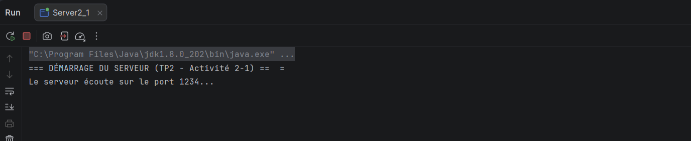
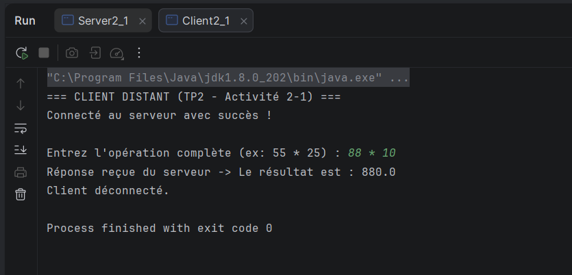
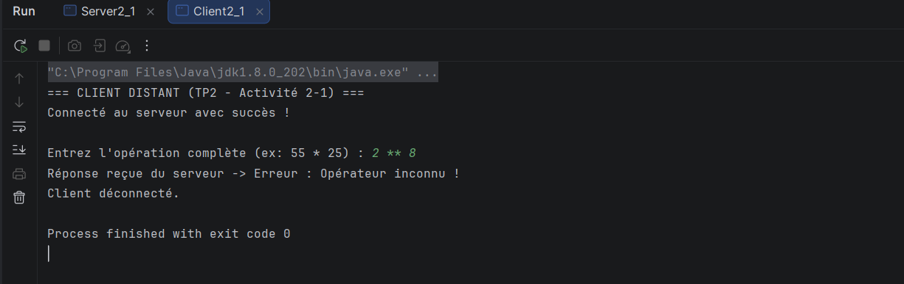
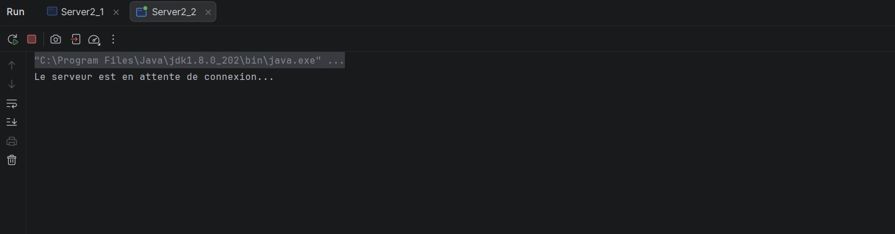
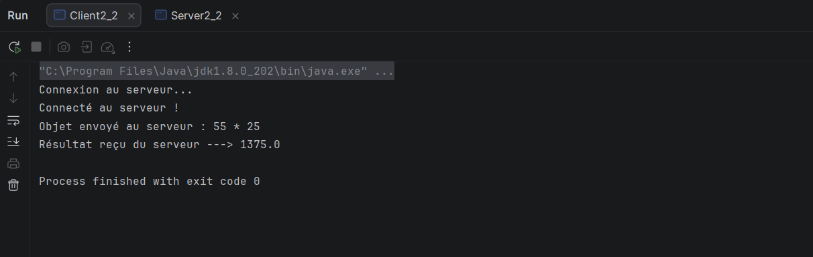
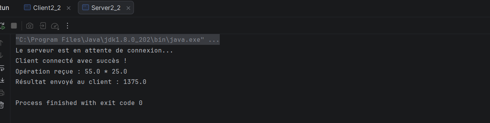

# TP2 – Activité 2-1 : Échange de chaînes de caractères entre Client/Serveur via les sockets TCP

1. ## Présentation du projet

Ce projet est réalisé dans le cadre du TP2 de la matière **Développement d’applications réparties**, durant l’année universitaire 2026–2027, à la Faculté des Sciences de Sfax.

L’objectif principal est de développer une application Java Client/Serveur utilisant les **sockets TCP** pour permettre l’échange de chaînes de caractères et l’exécution d’opérations arithmétiques.

Contrairement à la première version, qui se limitait à l’échange d’un seul octet, cette application permet au client d’envoyer une opération complète au serveur, de recevoir le résultat calculé et de l’afficher.

## 2. Objectifs du TP

Les principaux objectifs de cette activité sont :

-
Comprendre le fonctionnement de la communication Client/Serveur avec les sockets TCP en Java.
- 
Permettre l’envoi et la réception de chaînes de caractères.
- 
Utiliser les flux de traitement du package `java.io`.
- 
Envoyer une opération arithmétique complète du client vers le serveur.
- 
Effectuer le calcul demandé côté serveur.
- 
Renvoyer le résultat au client et l’afficher.
- 
Comprendre les erreurs possibles lors de l'envoi et du traitement des données.

## 3. Technologies et outils utilisés

- **
  Langage de programmation :** Java
- **
  Communication réseau :** Sockets TCP
- **
  Gestion des entrées et sorties :** Package `java.io`
- **
  Environnement de développement :** IntelliJ IDEA
- **
  Gestion du code source :** Git et GitHub

## 4. Principe de fonctionnement

L'application repose sur une architecture Client/Serveur composée de deux parties :

### Client

Le client permet de saisir une opération arithmétique, de l'envoyer au serveur et de recevoir le résultat.

### Serveur

Le serveur écoute les connexions entrantes, reçoit les informations envoyées par le client, effectue le calcul demandé et transmet le résultat au client.

### Déroulement de la communication

1.
Le serveur démarre et attend une connexion.
2. Le client se connecte au serveur.
3. Le client envoie les informations correspondant à l'opération demandée.
4. Le serveur reçoit les données et effectue le calcul.
5. Le serveur renvoie le résultat.
6. Le client reçoit et affiche le résultat.

**Exemple :**

Le client envoie l'opération `55 * 25`.

Le serveur effectue la multiplication et renvoie le résultat `1375`.

Le client affiche ensuite le résultat reçu.

## 5. Captures d'écran et résultats

Les captures suivantes illustrent les différentes étapes de mon travail.

### 5.1. Démarrage du serveur

Cette capture présente le démarrage du serveur et son état d'écoute, lui permettant d'attendre une connexion du client.

### 5.2. Résultat du calcul

Cette capture illustre le traitement d'une opération arithmétique et le résultat obtenu lors de l'échange entre le client et le serveur.

### 5.3. Gestion d'une erreur de format

Cette capture présente un cas d'erreur lié au format des données ou de l'opération saisie.

Elle permet d'illustrer l'importance de vérifier les données reçues et de gérer les erreurs susceptibles de survenir pendant l'exécution.

## 6. Compétences acquises

La réalisation de cette activité permet de mettre en pratique les notions suivantes :

-
La communication entre applications réparties.
- 
L'utilisation des sockets TCP en Java.
- 
L'échange de chaînes de caractères entre un client et un serveur.
- 
La manipulation des flux d'entrée et de sortie avec `java.io`.
- 
La séparation des responsabilités entre le client et le serveur.
- 
Le traitement des opérations arithmétiques côté serveur.
- 
L'identification et la gestion des erreurs de format.

## 7. Conclusion

Ce TP m'a permis d'approfondir mes connaissances en développement d'applications réparties avec Java et les sockets TCP.

J'ai étudié le passage d'un échange limité à un seul octet vers un échange de chaînes de caractères permettant de transmettre une opération arithmétique complète.

Cette activité constitue une étape importante dans la compréhension des communications réseau et du modèle Client/Serveur.

---

# TP2 – Activité 2-2 : Échange d'objets entre Client/Serveur via les Sockets TCP

## 1. Présentation et Objectifs
Cette seconde activité permet de passer à un niveau supérieur : au lieu d'envoyer de simples chaînes de caractères, le client envoie un **objet Java sérialisable** (`implements Serializable`) contenant les arguments de l'opération (premier opérande, opérateur, deuxième opérande)[cite: 6, 7].
- Utiliser l'interface `Serializable` pour permettre la transmission d'objets[cite: 6].
- Utiliser les flux d'objets (`ObjectOutputStream` et `ObjectInputStream`) pour l'échange réseau[cite: 7].

## 2. Principe de fonctionnement
1. Le client crée une instance de la classe `Operation` (ex: `55 * 25`) et l'envoie via un `ObjectOutputStream`[cite: 7].
2. Le serveur reçoit l'objet via un `ObjectInputStream`, extrait les données, effectue le calcul, met l'objet à jour avec le résultat et le renvoie[cite: 7].
3. Le client lit l'objet reçu et affiche le résultat final[cite: 7].

## 3. Captures d'écran et résultats (Activité 2-2)

### 3.1. Serveur en attente de connexion
Cette capture montre le démarrage du serveur et sa mise en écoute.

### 3.2. Exécution du client
Cette capture illustre l'exécution du client qui envoie l'objet opération et reçoit le résultat calculé.

### 3.3. Traitement et réponse du serveur
Cette capture présente la réception de l'objet, le traitement du calcul et l'envoi de la réponse par le serveur.
